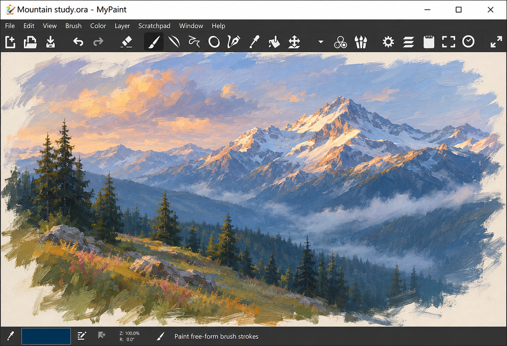
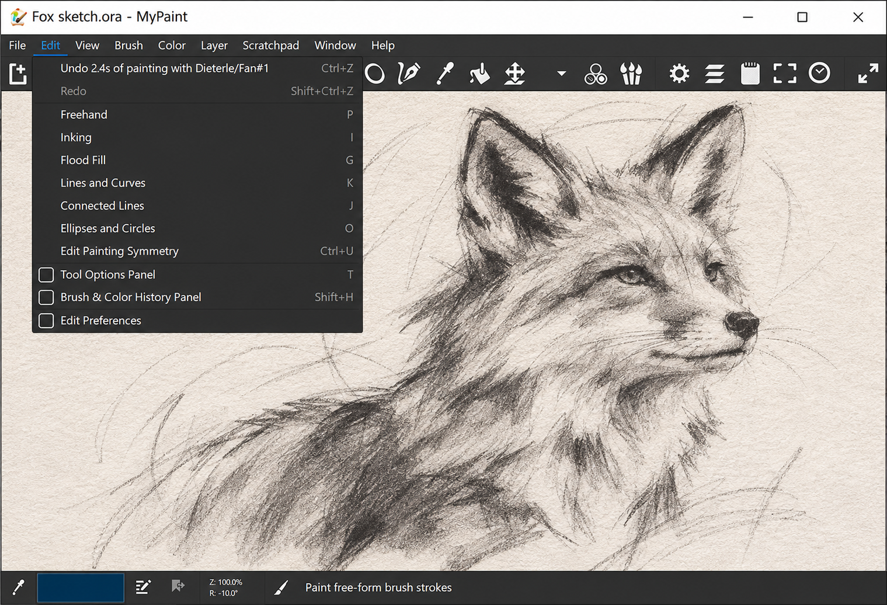

# MyPaint Infinite Canvas - Natural Digital Painting For Artists

MyPaint Infinite Canvas is the focused painting repository maintained by MyPaint Painting. It provides a fast, expressive workspace built around natural brush strokes, tablet input, layers, color controls, and an expandable canvas.

[](https://mypaint-painting.github.io/mypaint-infinite-canvas/MyPaint)

## Features

- Infinite canvas for unrestricted sketching and painting.
- Configurable brushes with stroke-specific settings.
- Pressure-sensitive graphics tablet input.
- Distraction-free painting and fullscreen workflows.
- Realistic color and pigment behavior.
- Layers, layer groups, and multiple blending modes.
- Color wheels, palettes, sliders, and color pickers.
- Autosave, document recovery, history, and undo support.
- Symmetry, line modes, flood fill, and freehand painting.
- Keyboard-driven controls for efficient creative work.



MyPaint Painting keeps the interface close to the artwork. MyPaint Infinite Canvas connects the drawing window, document model, tiled canvas, brush controls, and layer system without turning the application into a general-purpose publishing suite.

### What are the key features of a good painting?

A good painting made with MyPaint Painting combines clear composition, intentional color choices, controlled values, expressive edges, and brushwork appropriate to the subject. MyPaint Infinite Canvas supports that process with an unrestricted workspace, natural stroke rendering, configurable brushes, and layers that separate major visual elements.

Pressure-sensitive input helps vary opacity and stroke width naturally. The color wheels, palette controls, picker, symmetry system, and blending modes help artists maintain visual consistency. History and autosave support experimentation without making every decision permanent.

### What is a good painting software?

Good painting software should respond quickly, preserve the natural character of each stroke, support graphics tablets, and keep controls accessible without obscuring the artwork. MyPaint Painting is designed around those priorities. MyPaint Infinite Canvas emphasizes freehand painting, customizable brushes, pressure sensitivity, color selection, layers, and a distraction-free interface.

The application is particularly suitable for sketching, illustration, concept exploration, and expressive raster artwork. Artists who need a focused brush-first workflow may prefer this approach over an editor dominated by selection, publishing, or transformation features.

## Creative Scope

mypaint painting, mypaint brushes, mypaint canvas, mypaint digital art, mypaint infinite canvas, mypaint brush engine, digital-painting, raster-graphics, infinite-canvas, brush-engine, drawing-app, pressure-sensitivity, open-source-art

## Download

MyPaint Infinite Canvas is distributed by MyPaint Painting through the download button above. The retained desktop integration is described by [the application metadata](desktop/mypaint.appdata.xml) and [desktop launcher](desktop/mypaint.desktop).

## Build/Test/Install

MyPaint Infinite Canvas uses Python for its application, interface, and document-management layers. The main launch path is [mypaint.py](mypaint.py), while [setup.py](setup.py) and [setup.cfg](setup.cfg) define the retained setup behavior.

A compatible Python environment, GTK bindings, MyPaint brush engine installation, and brush resources are required. From the repository root, the traditional demonstration command is:

```bash
python setup.py demo
```

The selected source snapshot does not retain every native brush-engine source file, packaging script, test asset, or platform installer from the original projects. A complete runtime therefore requires compatible external dependencies.

## Structure Of The Code

The application starts through [mypaint.py](mypaint.py), [gui/main.py](gui/main.py), and [gui/application.py](gui/application.py). Window and workspace behavior is organized through [gui/drawwindow.py](gui/drawwindow.py), [gui/workspace.py](gui/workspace.py), and [gui/windowing.py](gui/windowing.py).

The main interface definition is retained in [gui/mypaint.glade](gui/mypaint.glade). Painting input and canvas presentation are handled by [gui/freehand.py](gui/freehand.py), [gui/tileddrawwidget.py](gui/tileddrawwidget.py), and [gui/device.py](gui/device.py).

Document state is divided between [gui/document.py](gui/document.py) and [lib/document.py](lib/document.py). Layer behavior is implemented through [gui/layers.py](gui/layers.py), [gui/layermanip.py](gui/layermanip.py), and the [layer package](lib/layer/__init__.py). Commands and reversible operations are represented by [lib/command.py](lib/command.py).

Brush management is organized through:

- [Brush manager](gui/brushmanager.py)
- [Brush editor](gui/brusheditor.py)
- [Brush modifier](gui/brushmodifier.py)
- [Brush selection window](gui/brushselectionwindow.py)
- [Brush settings model](lib/brushsettings.py)
- [Brush integration](lib/brush.py)

MyPaint Painting uses these components to expose mypaint custom brushes while leaving stroke rendering to the compatible mypaint brush engine.

## UI Design

MyPaint Infinite Canvas uses a modular GTK interface. Panels and controls are composed by the application rather than being treated as a single static window. MyPaint Painting keeps painting controls available while preserving a large, uncluttered canvas.



Color interaction is distributed across [gui/brushcolor.py](gui/brushcolor.py), [gui/colorpicker.py](gui/colorpicker.py), [gui/colorpreview.py](gui/colorpreview.py), and [gui/colortools.py](gui/colortools.py). Specialized selectors include HSV wheels, cubes, squares, sliders, and palette views under [gui/colors](gui/colors/__init__.py).

Tool panels and overlays are coordinated by [gui/toolstack.py](gui/toolstack.py), [gui/optionspanel.py](gui/optionspanel.py), [gui/toolbar.py](gui/toolbar.py), and [gui/overlays.py](gui/overlays.py). View movement and canvas navigation are implemented in [gui/viewmanip.py](gui/viewmanip.py).

### Is MyPaint better than krita?

MyPaint Painting is not universally better; it is more focused. MyPaint Infinite Canvas prioritizes natural freehand input, mypaint brushes, a minimal interface, and rapid work on an unrestricted canvas. That focus can make it preferable for sketching and brush-driven illustration.

Krita provides a broader professional graphics environment with more extensive selection, transformation, animation, filter, and production features. Artists should choose MyPaint Painting when a direct painting experience matters most and choose a broader editor when their workflow depends on advanced post-processing or publishing facilities.

## Tools

MyPaint Infinite Canvas centers on painting tools rather than a large collection of unrelated editing systems.

### Brushes

The brush workflow supports brush selection, editing, color interaction, input-device handling, and configurable stroke behavior. MyPaint pressure sensitivity is processed through the device and freehand input layers, providing mypaint wacom support when the operating system and GTK input stack expose the tablet correctly.

### Colors

MyPaint colors can be selected through wheels, sliders, palettes, previews, and direct picking. Shared color operations are implemented by [lib/color.py](lib/color.py), while palette data is managed by [lib/palette.py](lib/palette.py).

### Layers

The layer system supports painting layers, groups, visibility, blending modes, and tree organization. Rendering responsibilities are separated into [lib/layer/rendering.py](lib/layer/rendering.py), while hierarchy behavior is implemented by [lib/layer/tree.py](lib/layer/tree.py).

### Fill And Line Work

Flood-fill behavior is represented by [gui/fill.py](gui/fill.py), [lib/fill_common.py](lib/fill_common.py), and [lib/floodfill.py](lib/floodfill.py). Line drawing modes are coordinated by [gui/linemode.py](gui/linemode.py), while mirrored work is supported through [gui/symmetry.py](gui/symmetry.py).

### How to make painting in MS paint?

This repository does not implement MS Paint. To create the painting with MyPaint Painting, start a document, choose a brush, select a color, and draw on the mypaint canvas with a mouse or pressure-sensitive tablet. Use layers to separate the background, sketch, color, shading, and highlights.

Adjust the brush through the editor and modifier controls, sample existing colors with the picker, and use history when an experiment does not work. MyPaint Infinite Canvas allows the composition to expand beyond an initial boundary, so the artist can develop the image without choosing rigid dimensions first.

## Settings

Preferences are managed through [gui/preferenceswindow.py](gui/preferenceswindow.py), while reusable application state and helper behavior are distributed across the GUI and library packages. Input shortcuts are handled by [gui/keyboard.py](gui/keyboard.py).

The mypaint keyboard shortcuts workflow is intended to keep the pointer on the canvas. Common actions such as tool changes, canvas navigation, brush adjustments, layer operations, and history traversal can be performed without repeatedly opening menus.

Configuration should preserve the distinction between user-visible labels and internal constants. Translatable interface strings should remain complete phrases so translators can reorder words and variables correctly.

## Documentation

This README provides the primary mypaint manual for the selected snapshot. A mypaint tutorial can begin with the brush manager, freehand input, canvas navigation, color controls, and layers. A mypaint layer tutorial should focus on creating separate paint layers, changing visibility, selecting blending modes, and organizing related layers into groups.

A mypaint digital painting tutorial should introduce pressure-sensitive strokes, brush customization, color selection, symmetry, and non-destructive layer organization. Developers can follow the application flow from [gui/application.py](gui/application.py) into the document, window, workspace, and tiled-canvas modules.

## Syntax And Comments

Python code should remain readable and consistent with the retained project configuration. Comments should explain why behavior exists, especially around input handling, canvas transforms, layer ownership, and translation context.

User-facing strings should be written as complete translatable messages. Variables should be inserted after translation rather than constructing sentences from separately translated fragments. Private implementation details should use names that clearly distinguish them from public interfaces.

## Contributing

MyPaint Painting welcomes focused improvements to MyPaint Infinite Canvas. Contributions should preserve the application’s brush-first design, responsive canvas behavior, translation support, and compatibility with graphics tablets.

Changes affecting selection, document state, canvas transforms, or layers should be checked across multiple documents and zoom levels. Undo and redo should be tested after switching documents, editing layers, changing selections, and applying drawing operations.

Changes to brush behavior should account for mypaint custom brushes, mypaint pressure sensitivity, stroke settings, and the boundary between the Python application and the mypaint brush engine.

## License

See [COPYING](COPYING).

## Contributors

MyPaint Painting recognizes the developers, artists, translators, testers, packagers, and documentation writers whose work shaped the original application and its related graphics projects. MyPaint Infinite Canvas continues that technical focus through a compact source selection centered on digital painting.
